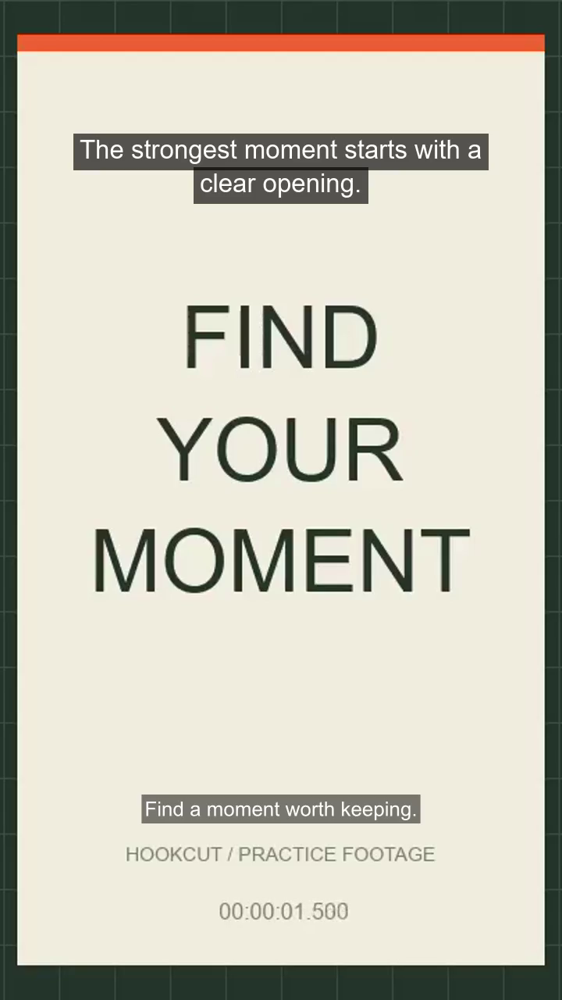

# Hookcut

A local hook library and clip preparation studio. Built for collecting openings, finding moments in longer footage, and exporting clean MP4 clips.

## What it does

- **Hook library:** 30 starter openings, custom hooks, categories, favorites, bulk import, and JSON backups.
- **Local transcription:** turn speech into an editable transcript without an API key or cloud upload.
- **Transcript to clip:** search phrases, preview lines, select a passage, and use its timestamps as your cut.
- **Captioned exports:** trim, reframe, add an opening hook, and burn captions directly into an H.264 MP4.
- **Repeatable workflow:** saved drafts, an export queue, cancellation, retries, and reusable clip settings.
- **Saved moments:** keep named cuts and notes per source, search them, and queue up to 20 together.
- **Export presets:** three starter presets and your own reusable framing, audio, and caption settings.
- **Find finished clips:** search titles, hook text, and source names; filter by status.

<details>
<summary>See an actual captioned export from the included practice footage</summary>
<br>

</details>

## Open the app

If using the ZIP, extract the entire `hookcut` folder first. The ZIP contains a fresh app, not your live `.data` library.

On Windows, double-click **Start-Hookcut.cmd**. It starts the app in the background and opens **http://127.0.0.1:4317** in your browser. You can close the launcher window; the app keeps running.

Double-click **Stop-Hookcut.cmd** when you want to stop it. Stop after exports finish, or cancel them first. If the app closes during an export, the export is marked for retry when you reopen it.

Install Node.js 22 or newer and FFmpeg with FFprobe on your PATH. There are **no npm packages to install, no API keys, and no paid services**. Automatic transcription additionally needs an FFmpeg build with the `whisper` filter; caption rendering needs the `subtitles` filter. The app detects these capabilities. Basic clipping and SRT import work without speech recognition support.

## Your first clip

1. Open **Hook library**. Search for a topic such as `wallet`, filter by category or niche, and click **Use in clip** on an opening you like.
2. Open **Clip studio** and import a video. To practice first, click **Try practice footage** in the empty preview.
3. Drag the orange timeline handles, enter start and end times, or move the playhead and click **Set at playhead**. Times can be seconds (`84.5`) or timestamps (`01:24.50` or `01:02:24.50`).
4. Choose **9:16**, **1:1**, **16:9**, or **Original**. Use the crop-position slider to keep your subject in frame. Choose **Keep full video** to add black bars instead of cropping.
5. Edit the attached hook. Optionally enable **Show hook in first 3 seconds**. Keep overlays concise; up to five wrapped lines are rendered.
6. Choose 720p or 1080p and click **Add to export queue**. You can prepare the next cut while the first one renders.
7. Open **Exports**, preview the result, and download the MP4. The attached hook can also be downloaded as a text file. **Edit a copy** restores the cut settings in the studio so you can make another version without changing the finished export.

## Save moments and export a batch

1. In **Clip settings**, choose an **Export preset** and click **Apply**, or configure the settings yourself. **Save settings** creates a custom preset. Applying a preset keeps your clip name, timing, hook text, and caption offset unchanged.
2. In **Keep the good moments**, click **Save selection** and add a name and optional notes. **Save next 15 seconds** bookmarks from the playhead, stopping at the end of the video.
3. Keep watching and save more selections. Each moment stores its own timestamps, framing, hook, audio, and caption options. **Load cut** restores it into the studio; **Edit details** changes its name and notes. To change a saved cut's timing, load it and save a new selection.
4. Select up to **20 moments**, then click **Queue selected**. The queue processes them in timeline order, one at a time. Captions are snapshotted from the source when queued. A retry of the same batch request reuses its exports; the most recent 50 request identifiers are retained.
5. In **Exports**, search by clip name, hook text, or source name and filter by status. **Show more clips** displays another 24 matching results.

You can keep up to 200 moments per source and 50 custom presets. Saved moments and presets persist locally in `.data`, alongside the library. Removing a source removes its moments; completed exports remain. Hook-library JSON backups contain hooks only. To back up the whole workspace, stop Hookcut and copy its `.data` folder privately.

The interface polls a small activity response while visible, fetches the full workspace only when its revision changes, and updates progress bars without rebuilding every card. Hidden tabs pause polling and refresh when visible again.

## Hook library

- 30 original starter prompts across clipping, crypto, podcasts, gaming, fitness, and general storytelling.
- Create, edit, delete, copy, favorite, and attach hooks to clips. Use **Save as new** while editing to keep both the original and your variation.
- **Paste hooks** adds up to 200 openings at once, one per line, with a shared category, niche, and tags. Duplicates are skipped.
- Search hook text, tags, niche, and notes. Filter by category, niche, and favorites.
- Sort by newest, most used, or alphabetical order. Usage counts increase when you attach a hook using **Use in clip**.
- Each hook supports a source URL and notes. These are reference fields; Hookcut does not fetch or download source links.
- **Export library** downloads a portable JSON backup. **Import** adds hooks from that backup, skips matching text, and leaves existing hooks unchanged. Invalid imports are rejected before any hooks are added. Backup imports support up to 5,000 hooks and 32 MB per file.
- Starter hooks are writing prompts, not claims about measured performance. Adapt each hook to your footage and experience.

## Video details

- Imports: MP4, MOV, MKV, WebM, M4V, AVI; up to **2 GB per video**. A local working copy is created; your original file is not modified.
- Outputs: H.264 video and AAC audio in an MP4 container, with fast-start playback. Silent sources and optional audio removal are supported.
- Vertical: 720 × 1280 or 1080 × 1920. Square: 720 × 720 or 1080 × 1080. Landscape: 1280 × 720 or 1920 × 1080.
- Original mode preserves the display aspect ratio, makes dimensions even for compatibility, and does not upscale. It limits the longest edge to 1280 or 1920 according to the selected quality.
- Crop position moves left/right for wide footage and up/down for tall footage. Cropping is fixed for the whole clip; there is no automatic face tracking.
- Phone rotation metadata is respected. Non-square source pixels are normalized for output.
- The browser may not play every codec that FFmpeg can export. If playback is unavailable, you can still enter times and export, or use an H.264 MP4 source for preview.
- Composition guides are approximate, are not platform certification, and do not appear in exports.
- The practice video is original, generated demo footage. Its quiet tone is included so you can test audio removal.

## Transcribe, find a passage, export

1. Import a video with speech, then scroll to **Find it in the words**. For practice, import the included `samples/speech-demo.mp4`, an original narrated demo with a synthetic voice.
2. Click **Download speech model · 78 MB** once. Hookcut downloads the multilingual Whisper tiny model and verifies its SHA-256. The model stays in your local `.data/models` folder.
3. Choose a language or let it detect one, then click **Generate transcript**. Progress and cancellation are available. Only one transcript generates at a time; you can keep preparing clips while it runs.
4. Search for a phrase. Click a transcript line to jump to its timestamp. **Start here** starts a passage; **End here** extends it, including intermediate lines even when your search hides them.
5. Click **Use passage as clip** to apply the passage's start and end, including the timing offset. Preview and fine-tune the cut with the timeline.
6. Use **Edit** beside any line to correct its text. Enable **Burn captions into video** to render the captions into the exported MP4. **Include captions (.srt)** also makes a separate subtitle file available.

The tiny model is chosen for a small download and CPU use. Its output needs review, especially for names, crypto terminology, music, silence, and mixed languages. It produces segment-level timestamps, not word-by-word karaoke captions. Downloading the model requires internet; transcription runs locally after that. Regeneration replaces source captions only after it succeeds. Cancellation or failure preserves the existing captions.

## Subtitles and playback speed

In Clip studio, **Import SRT** attaches an existing subtitle file to the selected source. The included `samples/practice.srt` matches the practice video.

- Subtitles appear in the source preview. Use **Timing offset** when they need alignment: a positive value delays captions and a negative value makes them appear earlier.
- With **Include captions (.srt)** enabled, an export trims captions to the clip, clamps partial cues at its edges, and resets the timestamps to begin at clip time zero.
- **Captions .srt** appears on completed exports that contain caption cues. Import that file alongside the video in your editor or publishing workflow.
- **Burn captions into video** embeds readable white captions with a dark background near the bottom. Opening-hook text can appear at the top for the first three seconds. A captioned export also retains its matching SRT. Browser preview and rendered typography can differ slightly.
- Each queued export captures its own captions. Replacing or removing source subtitles does not change earlier exported SRT files. **Edit a copy** uses the current source captions with the saved timing offset.
- Subtitle import accepts UTF-8 SRT, up to 1 MB and 10,000 cues. Basic markup is stripped. Malformed timing is reported before replacing any existing captions.
- Playback speed can be 0.5×, 1×, 1.5×, or 2×. This changes only source preview playback; exported clips retain their original speed.

## Keyboard shortcuts

In the library, `/` focuses search. In the studio:

| Key | Action |
| --- | --- |
| Space | Play / pause, when a text field or button does not have focus |
| I | Set the start at the playhead |
| O | Set the end at the playhead |
| Left / Right | Seek by one second |
| Shift + Left / Right | Seek by five seconds |
| Escape | Close an open dialog |

Text-entry fields keep their normal keyboard behavior.

## Where your work is saved

All app data is stored beside the app in **.data/**:

- `library.json`: hooks, source metadata, saved moments, export presets, batch request records, and export history.
- `videos/`: imported source copies and parsed subtitle files.
- `exports/`: generated MP4s and rendering support files.
- `models/`: the verified local speech model.
- `transcriptions/`: temporary recognition work, cleaned after each job.
- `server.log`: startup and processing diagnostics.

The studio remembers the current source and editing settings in your browser's local storage. Use the same browser and address to restore those settings. Hook records, source copies, and completed exports persist independently of browser storage.

For a complete backup, stop Hookcut and copy the whole app folder, including `.data`. A hook JSON backup contains only hooks, not videos or clip files. Do not delete `.data` if you want to keep your work.

Removing a source deletes its imported copy, attached captions, and saved moments. Your original file stays unchanged. Completed exports remain downloadable, but failed exports cannot be retried after their source has been removed. Removing an export deletes its generated file. These actions ask for confirmation inside the app.

## Moving to another computer

Install **Node.js 22 or newer** and **FFmpeg with FFprobe**, add them to PATH, and copy this folder. For custom locations, set `FFMPEG_PATH`, `FFPROBE_PATH`, or `HOOKCUT_FONT`. The overlay renderer looks for Arial on Windows/macOS and DejaVu Sans on Linux. The Windows launcher uses port 4317 by default; `PORT` can select another port.

Run `npm start` for a foreground server or `node launcher.mjs --no-browser` for a background server. The server binds only to the current computer at 127.0.0.1. Responsive layouts fit narrow browser windows, but this build is not hosted and is not accessible from your phone over the network.

## Current scope

Hookcut supports manual and transcript-assisted clipping. It does not generate AI hooks, download from video URLs, automatically detect highlights, track speakers, post to social platforms, or connect to Whop. No Whop credentials or wallet connection are needed.

## Verification

Run `npm test` to run the automated checks. Tests use isolated temporary data, create synthetic video, and verify real outputs with FFprobe. The optional speech integration test runs when `HOOKCUT_TEST_MODEL` points to the verified model ; otherwise it is explicitly skipped. See **QA.md** for the tested workflows and known limits.

## How it is built

```text
Browser UI → local Node.js server → FFmpeg / Whisper
                    ↓
             .data/ on your disk
```

Vanilla JavaScript and CSS keep the browser app small. Node's built-in HTTP, filesystem, and process APIs handle storage and job coordination. FFmpeg performs real video rendering and runs Whisper locally. Exports capture their captions at submission, so later edits cannot change an earlier cut. The app uses fixed local routes, validates clip boundaries, and keeps render processes outside the browser.

Key source locations: `public/` contains the UI; `server.mjs` owns the local API and export queue; `lib/transcription.mjs` manages verified model downloads and speech jobs; `lib/caption-render.mjs` safely prepares rendered captions; `tests/` covers actual media workflows and validation.

## Publishing safely

The repository contains application code and approved demo material. It excludes your `.data` workspace, private videos, hook backups, transcripts, exports, logs, model binaries, and environment files. The local publication check inspects staged files before commits; GitHub Actions runs it with the app tests. See [SECURITY.md](SECURITY.md) for the privacy boundaries and limitations of automated scans.

Upstream documentation: [FFmpeg Whisper filter](https://ffmpeg.org/ffmpeg-filters.html#whisper), [whisper.cpp](https://github.com/ggml-org/whisper.cpp), and [model files](https://huggingface.co/ggerganov/whisper.cpp). These tools and models retain their respective upstream licenses; no third-party binaries or fonts are bundled.
